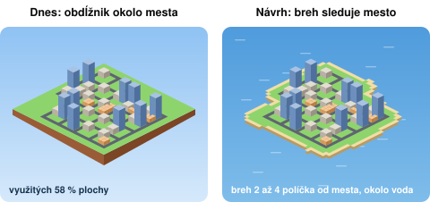
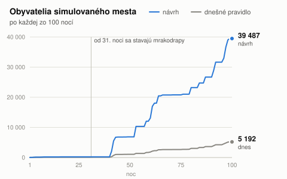
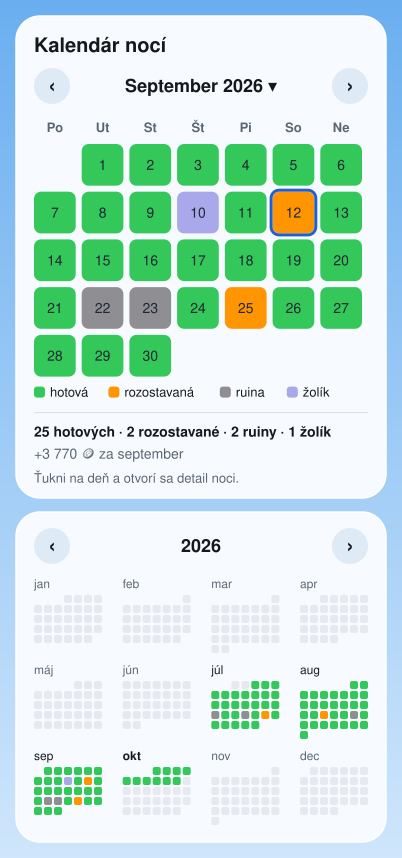
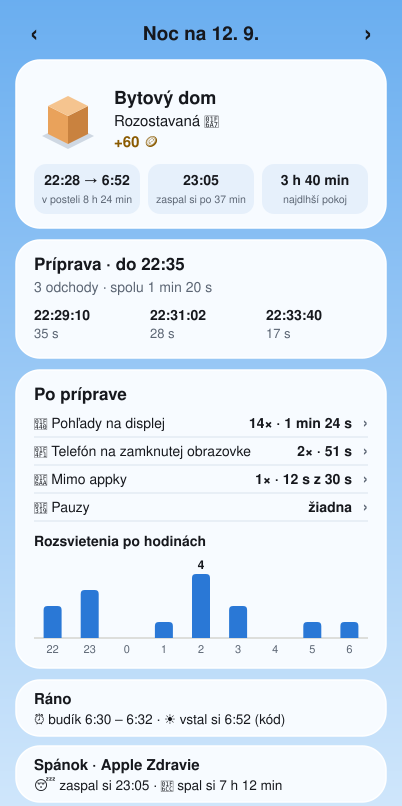
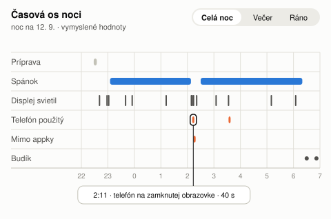
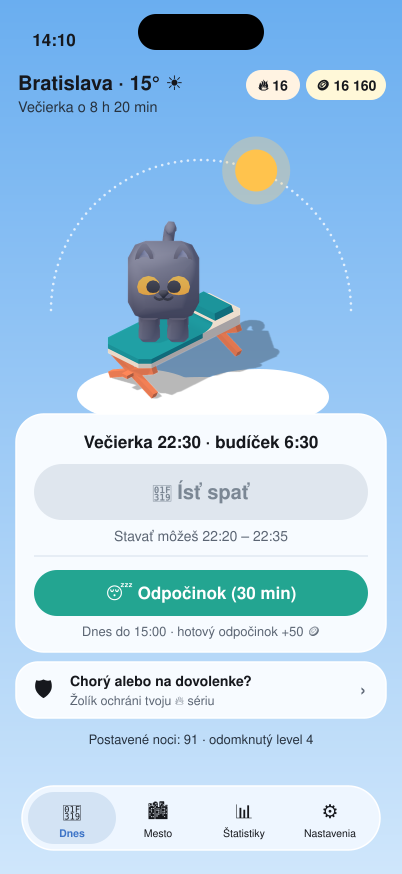

# Návrhy po simulácii 100 nocí

Stav k 10. 10. 2026. **Nič z tohto dokumentu nie je postavené.** Každý návrh čaká na Tvoje áno a stavia sa po
jednom, s kontrolou na telefóne.

<!--md-only-->
Verzia s obrázkami zo simulácie je PDF v iCloud Drive (`SleepHole/NAVRH-2026-10-10.pdf`). Screenshoty sú lokálne
v `build/shots/sim100/`, do repa nejdú.
<!--/md-only-->

Nákresy v tomto dokumente sú návrhy, nie hotové obrazovky, a hodnoty v nich sú vymyslené.

## Zhrnutie

| # | Návrh | Čo uvidíš | Veľkosť |
|---|---|---|---|
| 1 | Oddialenie mesta | celé mesto sa dá vždy oddialiť, appka si pamätá Tvoj pohľad | S |
| 2 | Ostrov | pobrežie sleduje mesto, okolo je voda | M |
| 3 | Obyvatelia | 100 nocí je asi 40 tisíc ľudí, mesto má názov veľkosti | S |
| 4 | Kalendár a obdobia | mesačný kalendár s tlačidlami, celý rok na jednej obrazovke | M |
| 5 | Detail noci | samostatné bloky, tabuľky, časová os noci | M |
| 6 | Obrazovka Dnes | obe hlavné tlačidlá bez posúvania, mesto a teplota v hlavičke | S–M |
| 7 | Mince | záväzok prísneho režimu, stavebný úrad, služby mesta | S, M, L |
| 8 | Senzory | svetlo nejde, navrhujem pokus s pohybom telefónu | S |
| 9 | TestFlight | verejný odkaz pre viac kamarátov | bez kódu |

Veľkosti: **S** je jeden krok workera, **M** sú 2–4 kroky s kontrolou, **L** je samostatná fáza.

<!--pdf:fig town-growth.jpg | Simulované mesto po 10, 30, 60 a 100 nociach. Je to vývojársky pohľad, ktorý mesto vtesná celé. Bežný používateľ ho takto nevidí.-->

## 0. Čo som povedal zle

Simuláciu som si teraz prehral mimo appky tým istým kódom. Počty budov a obyvateľov vyšli na číslo rovnako ako
na screenshotoch (9 / 92, 26 / 108, 53 / 1 828, 93 / 5 192), takže čísla nižšie sú spočítané, nie odhadnuté.

- **„Mapa stačí asi na 130 až 150 budov.“ Nie je to pravda.** Mapa nemá pevný okraj. Bloky pribúdajú v špirále
  bez limitu a tráva sa zväčšuje s nimi. Na okraj nikto nenarazí.
- **„Pri 100 je zastavaných okolo 60 % šírky.“** Číslo sedí (58 % plochy), dôvod bol iný. Tráva je vždy obdĺžnik
  okolo všetkého zastavaného. Keď špirála začne nový prstenec blokov, obdĺžnik narastie o celý pás, hoci v ňom
  stojí jediný blok.
- **V dnešnom pláne, ktorý si schválil, boli dva moje odhady vedľa.** Napísal som, že strop oddialenia je pri
  100 nociach „tesne za“ potrebou a že tretí prstenec začína pri asi 140 budovách. Presne: strop prestáva
  stačiť okolo 45. noci a tretí prstenec začína okolo 90. noci. Návrh sa tým nemení, dôvod preň je silnejší.

## 1. Mesto: oddialenie

Mierka hovorí, koľko bodov mesta pripadá na jeden bod obrazovky. Väčšie číslo znamená menšie mesto na obrazovke.
Prvý pohľad má dnes strop 4,5 a oddialenie prstami strop 10 (`TownScene`).

<!--pdf:fig zoom-overlay.jpg | Čo dnes ukáže kamera v meste po 100 nociach.-->

Mierka, ktorú treba, aby sa mesto zmestilo na šírku obrazovky (iPhone 16 Pro):

| Nocí | Celý ostrov | Zastavaná časť | Prvý pohľad dnes ukáže |
|---|---|---|---|
| 10 | 8,4 | 5,8 | 82 % šírky zastavanej časti |
| 30 | 13,4 | 7,4 | 64 % |
| 60 | 15,1 | 11,7 | 40 % |
| 100 | 20,1 | 15,1 | 31 % |
| 365 | 33,5 | 28,0 | 17 % |

Zastavaná časť sú cesty a budovy vrátane obrysu ďalšieho bloku. Riadok 365 je hráč, ktorému vyjde každá noc.

**Tvoj argument platí, ale len do zhruba 45. noci.** Dovtedy sa zastavaná časť dá oddialiť celá. Pri 100 nociach
ukáže najväčšie oddialenie asi 70 % jej šírky, po roku asi 37 %. Mesto vcelku sa potom nedá vidieť žiadnym gestom.

Druhá vec: appka si pohľad nepamätá. Po novom spustení sa kamera vráti do stredu obdĺžnika, nie tam, kde si
skončil, a nová budova nemusí byť v zábere.

**Návrh (S):**

1. Strop oddialenia rastie s mestom. Vždy sa dá oddialiť tak, aby bolo vidno celý ostrov.
2. Appka si pamätá Tvoj posledný pohľad (mierku aj miesto) aj po reštarte.
3. Po noci, ktorá pridala budovu, kamera prejde na ňu.

Prvý pohľad pre nového používateľa ostáva ako dnes. Automatické vtesnanie nenavrhujem: pri veľkom meste by boli
budovy drobné a Ty si už dvakrát povedal, že kamera Ti takto vyhovuje.

Súbory: `SleepHole/Town/TownScene.swift`, pravidlo mierky ako čistá funkcia v `SleepCore/.../TownRender.swift`
s testom. Chybu B30 v zozname prepíšem na tieto tri body.

## 2. Ostrov, ktorý rastie s mestom

Ostrov sa mestu prispôsobuje už dnes, ale len veľkosťou a vždy ako obdĺžnik. Preto je pri 100 nociach
využitých 58 % plochy a zvyšok sú prázdne lúky v rohoch.

Kedy začína nový prstenec blokov (hráč, ktorému vyjde každá noc):

| Prstenec | Blokov spolu | Začína okolo noci |
|---|---|---|
| 1 | 4 | 1 |
| 2 | 16 | 25 |
| 3 | 36 | 90 |
| 4 | 64 | 195 |
| 5 | 100 | 335 |
| 6 | 144 | 520 |

**Návrh (M, tri kroky):**

1. **Tvar.** Nová čistá funkcia `Island.land(layout, seed)` v SleepCore. Pevnina sú začaté bloky a blok
   vopred, rozšírené o 2–3 políčka, so zaobleným a nepravidelným okrajom. Okraj sa odvodí zo semienka mesta,
   takže každý používateľ má iný ostrov a ten istý používateľ vždy rovnaký. Pevnina sa nikdy nezmenší. Testy:
   mesto sa vždy zmestí, rast len pridáva, rovnaký vstup dá rovnaký ostrov.
2. **Kreslenie.** Tráva len na pevnine, lem pri brehu, nízky breh namiesto dnešnej vysokej hliny
   (`TownRender.build`, `TownScene.addSoilEdge`).
3. **Voda.** Záložka Mesto má namiesto oblohy hladinu s pomalým odleskom. Kamera a strop oddialenia sa riadia
   obrysom ostrova.

Nič nové sa neukladá. Ostrov sa dopočíta z mesta, tak ako dnes mesto z nocí. Nadväzuje na deň a noc v meste
(TOWN-W krok 4), lebo hladina odráža oblohu.

**Otázky:** Voda cez celú záložku Mesto, alebo obloha s horizontom? Piesková pláž, alebo tráva až po vodu?

## 3. Obyvatelia

Dnešné pravidlo (`TownStats.population`): rodinný dom 4, bytový dom 20, veľký bytový dom 60, čokoľvek z L4 300.
Všetky budovy z L2 a L3 majú nulu. Preto má 26 budov len 108 ľudí a 93 budov s mrakodrapmi 5 192.

**Návrh (S):** každá budova dostane počet z rozsahu svojho druhu. Náhoda sa odvodí z noci a budovy, takže číslo
je stále rovnaké, aj po obnove zo zálohy.

| Budova | Dnes | Návrh | Typicky |
|---|---|---|---|
| Rodinný dom | 4 | 2–14 (7 z 10 domov má 2–5 ľudí, občas dvojgeneračný 10–14) | 5 |
| Bytový dom | 20 | 24–96 | 60 |
| Veľký bytový dom | 60 | 180–540 | 360 |
| Výšková budova | 300 | 600–1 400 | 1 000 |
| Mrakodrap | 300 | 1 500–4 000 | 2 750 |
| Parky, knižnice, múzeá, škola, hasiči, polícia, nemocnica, radnica | 0 | 0 (ľudí pritiahnu až ako služby, časť 7) | – |

Rozostavaná budova má polovicu, ruina nulu, opravená ruina plný počet. Tak je to aj dnes.

Čo to spraví so simulovaným mestom:

| Nocí | Budov | Obyvatelia dnes | Obyvatelia podľa návrhu | Veľkosť |
|---|---|---|---|---|
| 10 | 9 | 92 | 175 | Dedina |
| 30 | 26 | 108 | 224 | Dedina |
| 60 | 53 | 1 828 | 14 986 | Mesto |
| 100 | 93 | 5 192 | 39 487 | Veľké mesto |

Hráč, ktorému vyjde každá noc, má po 100 nociach 40 až 64 tisíc ľudí, po roku 200 až 240 tisíc a po dvoch rokoch
400 až 480 tisíc (tri rôzne žreby budov).

Skok ostáva: od 31. noci sa môžu stavať mrakodrapy a v simulácii prišiel prvý v 41. noci. Napísal si, že skoky
sú v poriadku.

**Veľkosť mesta** pod názvom v hlavičke:

| Obyvateľov | Názov |
|---|---|
| do 100 | Osada |
| do 1 000 | Dedina |
| do 5 000 | Mestečko |
| do 20 000 | Mesto |
| do 100 000 | Veľké mesto |
| do 500 000 | Veľkomesto |
| viac | Metropola |

V detaile budovy pribudne „Býva tu 9 ľudí“. V rannom výsledku môže byť „Prisťahovalo sa 2 340 ľudí“.

**Dve čísla, 93 budov a 91 nocí.** Hlavička mesta počíta stojace hotové budovy vrátane opravených ruín.
Štatistiky počítajú noci hotové a rozostavané. Navrhujem nemeniť ani jedno a pridať vysvetlenie: ťuknutie na
hlavičku otvorí „Mesto v číslach“ (hotové budovy, rozostavané, ruiny, osvetlené úseky ulíc, obyvatelia,
postavené noci). Spraví sa spolu s obyvateľmi, lebo hlavička sa aj tak mení.

**Voliteľne neskôr: postupné sťahovanie.** Ľudia sa do novej budovy nasťahujú počas piatich dobrých nocí. Číslo
potom rastie každé ráno, aj po noci s parkom. Nikdy neklesá.

**Vedľajší nález.** V simulovanom meste po 100 nociach stojí 5 nemocníc, 4 radnice, 4 hasičské stanice,
4 policajné stanice a 4 školy. Výber budovy žrebuje najprv level a L3 má len päť druhov. Riešenie patrí do
Stavebného úradu (časť 7).

Súbory: nový `SleepCore/.../Population.swift`, `SleepHole/Town/TownView.swift` (`TownStats`, `BuildingSheet`).

## 4. Kalendár a obdobia

Dnes kalendár ukazuje posledných 35 dní bez názvu mesiaca a bez dní v týždni, graf posledných 30 nocí a priemer
posledných 14 nocí. Všetky tri čísla sú pevné v `Stats.summary`. Po 100 nociach prvé dva mesiace nikde nevidno.

<!--pdf:fig stats-pair.jpg | Dnešné štatistiky po 100 nociach: kalendár posledných 35 dní a graf posledných 30 nocí.-->

**Krok 1 – skutočný kalendár.**

- Mesiac má 28 až 31 dní, hlavičku s dňami v týždni a tlačidlá ‹ ›. Týždeň začína podľa nastavenia telefónu.
- Listuje sa od mesiaca prvej noci po dnešok. Za hranicou sú tlačidlá neaktívne.
- Ťuk na názov mesiaca otvorí rok: 12 malých mesiacov s ‹ 2026 ›. Ťuk na mesiac sa doň vráti.
- Pod mriežkou je súčet mesiaca: hotové, rozostavané, ruiny, žolíky, mince.
- Farby ostávajú. Dnešok má krúžok, budúce dni sú prázdne.

**Krok 2 – všetko na stránke sa riadi zobrazeným obdobím.**

- Karty „Priemer“ a graf patria zobrazenému mesiacu („Priemer · september 2026“), s porovnaním oproti
  predošlému mesiacu.
- Prepínač Mesiac / Rok. V roku ukazuje graf mesačné priemery a kalendár celý rok.
- Štyri dlaždice hore (séria, najdlhšia séria, postavené noci, mince) ostávajú za celý čas.

Ako: čisté funkcie v `SleepCore/.../Stats.swift` – `MonthGrid` (týždne mesiaca) a štatistika pre ľubovoľné
obdobie. Testy: február s 28 aj 29 dňami, týždeň od pondelka aj od nedele, zmena času, mesiac pred prvou nocou.
Súbory: `Stats.swift`, `SleepHole/UI/StatsView.swift` (`CalendarGrid`, `NightChart`), `SleepHole/App/Localization.swift`.

## 5. Detail noci v blokoch

Dnes je detail jeden dlhý zoznam riadkov vnútri karty kalendára. Pri noci s mnohými pohľadmi na telefón sa
v ňom nedá vyznať.

Detail bude vlastná obrazovka. Otvorí sa z kalendára, z grafu aj z denníka a má šípky na predošlú a ďalšiu noc.

**Krok 1 – samostatné karty.**

- **Zhrnutie:** budova, výsledok, mince rozpísané na časti, kedy si ľahol a vstal, najdlhší pokojný úsek.
- **Príprava:** odchody počas prípravy – počet, súčet, tabuľka čas a trvanie.
- **Po príprave:** pohľady na displej, telefón na zamknutej obrazovke, odchody z appky, pauzy, hovory. Každý
  riadok má počet a súčet a dá sa rozbaliť na tabuľku.
- **Rozsvietenia po hodinách:** malý stĺpcový graf, ktorý ukáže, kedy v noci si sa pozeral na displej.
- **Ráno**, **Spánok** (Apple Zdravie), **Odpočinok** z toho dňa.

**Krok 2 – časová os noci.**

- Pásy: príprava, spánok, displej svietil, telefón použitý, mimo appky, pauza, hovor, budík.
- Prepínač Celá noc / Večer / Ráno. Ťuk na úsek ukáže, čo to bolo a ako dlho.
- Modrá je spánok, oranžová je to, čo sa noci počíta. Ostatné je neutrálne.

Dáta na to už sú. Začiatky aj konce rozsvietení sa do denníka píšu (`.screenOn`, `.screenOff`), appka ich dnes
neukazuje. Rozšíri sa `SleepCore/.../NightReport.swift` (úseky, súčty, najdlhší pokoj) a detail sa presunie zo
`StatsView.swift` do vlastného súboru.

**Ďalšie grafy na výber** (v mesiaci a v roku): čas zaspávania za noc, dĺžka spánku, rozsvietenia displeja za
noc. Tretí ukáže, či sa pozeráš na telefón menej než pred mesiacom. To je osveta, ktorú si chcel, bez trestu.

## 6. Obrazovka Dnes

<!--pdf:pair today-100.jpg | Teraz | previews/navrh-2026-10-10/dnes.svg | Návrh-->

| Prvok | Dnes | Návrh |
|---|---|---|
| Nadpis | veľké „Dnes“ | mesto a teplota, pod tým odpočet do večierky |
| Séria a mince | dve veľké kapsuly pod nadpisom | malé v hlavičke vpravo |
| Maznáčik | šírka 250 bodov | šírka asi 200 bodov, presne pod vrcholom oblúka |
| „Ísť spať“ | v 75 % výšky obrazovky | asi v 56 % |
| „Odpočinok“ | schovaný pod lištou záložiek | viditeľný, v tej istej karte |
| Žolík, level | až po posunutí | viditeľné |

- Bez nastaveného mesta je v hlavičke pozdrav a odkaz „Nastav mesto“.
- Výstražný trojuholník (vypnuté časovo citlivé upozornenia) sa presunie do hlavičky vľavo.
- **Oblúk slnka a mesiaca sa nemení** – stred 310 bodov, polomer 150. Slnko na poludnie ostane voľné medzi
  hlavičkou a maznáčikom.
- Dlhé vysvetlenie pod tlačidlom ostane len vtedy, keď sa dá začať stavať. Inak jeden riadok.

**Druhý krok neskôr: maznáčik hovorí.** Pod maznáčikom bublina s vetou dňa („Včera sa k nám prisťahovalo 212
ľudí“, „Hasičov ešte nemáme, ale máme dva pekné parky“). Potrebuje pravidlo `BuddyTalk` v SleepCore, ktoré
z mesta, série a poslednej noci vyberie vetu. Ťuk na maznáčika ukáže ďalšiu.

Súbory: `SleepHole/UI/TodayView.swift` (`HomeView`), `SleepHole/UI/Badges.swift`, `SleepHole/Weather/WeatherUI.swift`.

## 7. Mince: kam s nimi

V simulácii prišlo 16 160 🪙 za 100 nocí, teda asi 160 za noc a 1 100 za týždeň. S mincami za pokojné hodiny
(CARE-2, potvrdené, nepostavené) to bude asi 1 700 za týždeň. Míňať sa dnes dá len na žolíky, pauzy
a premenovanie mesta.

### E1 – Prísny režim ako záväzok (S)

Tvoj nápad, podľa mňa dobrý. Návrh pravidla:

| Kedy | Vypnutie stojí |
|---|---|
| prvých 24 hodín po zapnutí | nič (skúšobná doba, kryje omyl) |
| 1.–3. deň v mesiaci | nič (rovnako ako zmena večierky) |
| inokedy | 1 000 🪙 |

Zapnutie je vždy zadarmo a pred potvrdením ukáže toto pravidlo. Kto mince nemá, počká na začiatok mesiaca.
Pravidlo `StrictPolicy` podľa vzoru `RenamePolicy` a `SchedulePolicy` v `Limits.swift`, výdavok cez `CoinSpend`.

Na zváženie neskôr: prísna výzva na 7, 14 alebo 30 nocí s odmenou na konci. Dáva dôvod režim zapnúť, nielen
cenu za vypnutie.

### E2 – Stavebný úrad (M)

Dnešná budova ostáva náhodná a zadarmo. Nové:

- **„Iný návrh“ za 25 🪙** – nový žreb, ak sa Ti dnešná budova nepáči.
- **„Vybrať budovu“ za cenu levelu** – 100 / 200 / 400 / 1 000 🪙 (Tvoje ceny z 30. 9.).
- Kúpená budova čaká, kým ju postaví hotová noc. Pri ruine sa nestráca.
- **Zbierka:** 107 druhov budov, pri každej koľkokrát stojí. Dôvod kupovať je výber a zbierka, nie nutnosť.
- **Jedinečné budovy:** radnica len jedna, ostatné služby podľa veľkosti mesta. Žreb potom vyberá z iného.
  Mení to pravidlo výberu budovy (D13), preto to chce Tvoje áno.

### E3 – Služby mesta (L)

SimCity, ale bez trestov. Služba beží, keď je zaplatený jej týždenný rozpočet. Čísla sú návrh na doladenie:

| Služba | Týždenne | Čo dáva, keď beží |
|---|---|---|
| Hasiči | 150 🪙 | +8 % obyvateľov, hasičské auto v uliciach |
| Polícia | 150 🪙 | +8 % obyvateľov, policajné auto |
| Nemocnica | 200 🪙 | +10 % obyvateľov, sanitka |
| Škola | 150 🪙 | +8 % obyvateľov |
| Radnica | 100 🪙 | vráti 5 % mincí z nocí |
| Kultúra (knižnice, múzeá) | 100 🪙 | +5 % obyvateľov |
| Parky | 50 🪙 | +5 % obyvateľov |
| Spolu | 900 🪙 | až +44 % obyvateľov |

Nezaplatená služba má zatvorené a bonus chýba. Sprity hasičského auta, policajného auta a sanitky už máme.
Maznáčik o tom hovorí („Hasiči majú tento týždeň zatvorené“).

### Kde nesúhlasím

**Horiace budovy, kriminalita a úpadok.** Včera si rozhodol „starostlivosť namiesto vynucovania“ a tvrdé
pravidlo znie „milo, nikdy kruto“. Mesto, ktoré horí pre nezaplatený poplatok, je vynucovanie inou cestou.
Trestá aj toho, kto spí dobre, len sa mu nechce spravovať rozpočet. A prestane platiť, že mesto je obraz
Tvojich nocí.

Navrhujem zásadu: **budovu môže vziať len noc, nikdy mince.**

Mierna verzia Tvojho nápadu, ak chceš napätie: bez hasičov sa po „požiari“ časť ľudí odsťahuje a vráti sa, keď
služba beží. Žiadna budova nezmizne.

**R&D centrum** (otvorený nápad z 2. 10.) odporúčam zrušiť. Stavebný úrad dáva ten istý výdavok a nebrzdí rast.

## 8. Senzory: svetlo, pohyb, mikrofón

**Svetlo: nejde.** iOS senzor okolitého svetla appkám nedáva. Jediná cesta je SensorKit a ten Apple povoľuje
len schváleným výskumným štúdiám. Náhrada cez jas displeja tiež nefunguje: pri zamknutom telefóne sme 9. 10.
namerali 0,00, či displej svietil, alebo nie.

**Čo vieme bez povolení už dnes:**

- kedy a ako dlho svietil displej,
- použitie telefónu na zamknutej obrazovke (rozpoznaný používateľ, alebo telefón v ruke),
- odchody z appky, pauzy, hovory, zatvorenie appky,
- nabíjanie a stav batérie (appka ich vie čítať, do denníka noci ich zatiaľ nepíše),
- spánok z Apple Zdravia, ak ho používateľ povolil.

To je obsah časovej osi v časti 5. Na osvetu to stačí.

**Pokus (S): pohyb telefónu celú noc.** Snímač pohybu dnes beží len pri rozsvietenej zamknutej obrazovke.
Navrhujem jednu reálnu noc so záznamom po minútach a zmerať, čo to stojí batériu. Prinesie pás „pohyb“ do
časovej osi, odhalí zdvihnutie telefónu bez rozsvietenia a dá podklad pre „+11 za hodinu bez pohybu“ z CARE-2.
Čas zaspatia z toho spoľahlivo nevyčítame, ak telefón leží na nočnom stolíku. Na to je lepšie Apple Zdravie.

**Mikrofón: technicky áno, teraz neodporúčam.**

- Apple ho sleep appkám povoľuje, treba text povolenia. Pri spracovaní len v telefóne ostáva v App Store
  štítok „Data Not Collected“.
- Proti: oranžová bodka mikrofónu celú noc, zásah do `AudioKeeper` (od neho závisí budík) a dôvera
  používateľov. Mikrofón v spálni je iná vec než snímač pohybu.
- Ak niekedy, tak voliteľne a ukladať len hlasitosť po minútach. Nikdy zvuk.

## 9. TestFlight: viac testerov cez odkaz

**Prečo tester nič nevidí, najpravdepodobnejšie.** Pridanie v Users and Access je len členstvo v tíme a mail
z neho vedie na web App Store Connect. Do TestFlightu ho pustí až druhý krok:

1. App Store Connect → Apps → SleepHole → TestFlight → **Internal Testing** → skupina (ak nie je, **+**).
2. V skupine **Invite Testers** → zaškrtni ho. Potom **Add Builds** → zostavenie 2.
3. Jemu príde druhý mail. Otvorí ho **na iPhone**, kde má nainštalovaný TestFlight a je prihlásený tým istým
   Apple ID → **View in TestFlight** → Accept → Install.

**Pre viac kamarátov je správna cesta verejný odkaz:**

1. TestFlight → **External Testing** → **+** → skupina, napr. „Kamaráti“. Apple vyžaduje, aby predtým
   existovala interná skupina.
2. **Add Builds** → zostavenie 2 → vyplň „What to Test“ a Test Information (texty sú v návode, časť 5).
3. **Submit Review**. Zostavenie pre externých testerov kontroluje Apple, spravidla do dňa.
4. Po schválení: skupina → **Testers** → **Create Public Link** → **Open to Anyone** → **Set Limit**, napr. 20.
5. Odkaz pošli kamarátom. Nainštalujú si TestFlight z App Store a ťuknú naň.

Nepotrebuješ ich e-maily a nemajú prístup do Tvojho účtu. V zozname testerov budú anonymne, uvidíš inštalácie,
spustenia a pády. Zostavenie platí 90 dní, externých testerov môže byť až 10 000.

**Zníž kamarátovi rolu.** App Manager spravuje celú appku vrátane ceny a posielania verzií. Na testovanie stačí
Marketing. Po prechode na verejný odkaz ho z tímu môžeš odobrať.

**Text pre kontrolu Apple** (pole Review Notes, po anglicky) je v návode `TESTFLIGHT-NAVOD.md`: prečo appka hrá
v noci zvuk na pozadí, ako zisťuje zamknutie a ako si kontrolór spustí noc.

## 10. Poradie a otázky

**Odporúčané poradie:**

1. TestFlight verejný odkaz – dnes, Tvoje kliknutia.
2. Kalendár a obdobia (4). Dá sa stavať súčasne s obyvateľmi (3), sú to iné súbory.
3. Detail noci (5).
4. Obrazovka Dnes (6).
5. Oddialenie mesta (1).
6. Maznáčik hovorí – bublina.
7. Ostrov (2).
8. Mince: E1, potom E2, potom E3.
9. Pokus s pohybom telefónu – kedykoľvek, potrebuje jednu reálnu noc.

Zo skoršieho stále čaká: mince za pokojné hodiny (CARE-2), pokus s Live Activity, dážď a sneh v meste.

**Otázky na Teba:**

1. Sedí poradie?
2. Dnes: môže byť maznáčik menší (250 → asi 200 bodov)? Je to prijatý vzhľad, mením ho len na Tvoje slovo.
3. Ostrov: voda cez celú záložku Mesto, alebo obloha s horizontom? Pláž, alebo tráva až po vodu?
4. Obyvatelia: sedia rozsahy a názvy veľkostí? Chceš aj postupné sťahovanie?
5. Prísny režim: 1 000 🪙 za vypnutie? Kto mince nemá, počká na začiatok mesiaca?
6. Ekonomika: súhlasíš so zásadou, že mince budovu nikdy nezoberú?
7. Oddialenie: stačí strop a zapamätaný pohľad, bez automatického vtesnania?
8. Jedinečné budovy: má byť radnica v meste len jedna?

## Príloha: ako som počítal

Slučku `-seedNights` z `AppModel` (semienko 3, každá desiata noc rozostavaná, každá desiata ruina, automatické
bronzové žolíky) som spustil mimo appky nad `SleepCore` a z výsledku zložil mesto tým istým `TownBuilder`
a `TownRender`. Mierky sú pre obrazovku 402 × 815 bodov podľa vzorca v `TownScene.fitIfPossible`. Riadky pre
hráča, ktorému vyjde každá noc, sú z troch rôznych žrebov budov. Navrhované počty obyvateľov sú spočítané
pravidlom z časti 3. Nástroj je v scratchpade, do repa nejde.
